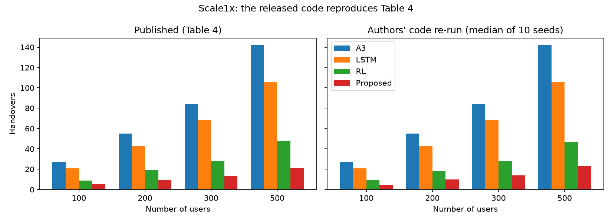
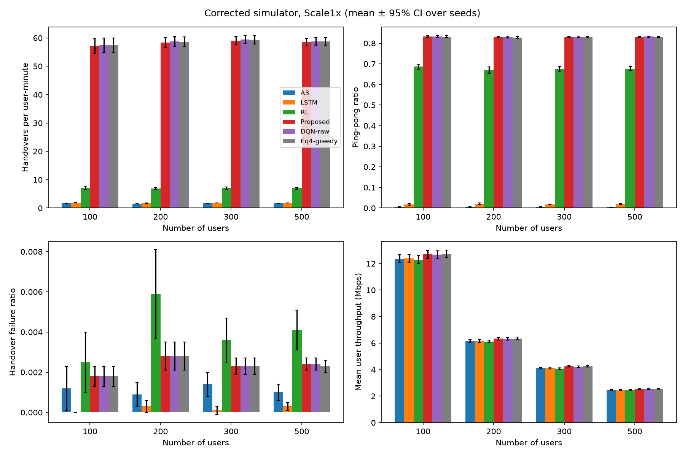

# Handover Reduction in 5G — Replication and Corrected Re-implementation

This repository re-examines the paper

> M. Jalili Sanjarani, Y. Elmi Sola, H. Hasanpour, A. A. Neghabi,
> *"Handover reduction in 5G mobile networks using ensemble learning method"*,
> Scientific Reports (2026), doi:10.1038/s41598-026-73269-1

which proposes an **Ensemble-DQN**: K-Means + PCA + Decision Tree features fed to a
Deep Q-Network that hands over only when Q(handover) − Q(stay) > 0.2.

The study has two parts:

| Part | Question | Where |
|---|---|---|
| **A. Faithful replication** | Does the authors' released code reproduce Table 4? | `replication/` |
| **B. Corrected re-implementation** | Does the method still help in a sound per-user simulation with real baselines? | `handover/`, `scripts/` |

---

## Part A — Faithful replication

`replication/run_replication.py` imports the authors' **unmodified** code
([mjs19971997/ensemble-dqn-5g-handover](https://github.com/mjs19971997/ensemble-dqn-5g-handover), commit `b61e399`)
and only orchestrates it.

**Result: Table 4 is reproduced.** The median over 10 experiment seeds (Scale1x, 30 Monte-Carlo runs each):

| Users | Method | Handovers (paper) | Handovers (ours) | Throughput (paper) | Throughput (ours) |
|---|---|---|---|---|---|
| 100 | A3 | 27.0 | 27.0 | 0.31 | 0.31 |
| 100 | LSTM | 21.0 | 21.0 | 6.59 | 6.59 |
| 100 | RL | 9.0 | 9.2 | 10.28 | 10.39 |
| 100 | Proposed | 5.1 | 4.6 | 10.90 | 11.05 |
| 500 | A3 | 142.0 | 142.0 | 0.14 | 0.14 |
| 500 | LSTM | 106.0 | 106.0 | 6.22 | 6.22 |
| 500 | RL | 47.6 | 47.1 | 10.43 | 10.43 |
| 500 | Proposed | 21.3 | 23.1 | 11.23 | 11.07 |

All user counts and metrics: `replication/results/seed_sweep_median_vs_table4.csv`.



**Caveat — training is seed-unstable.** With the code's own default seed (42), and with
seed 1, the DQN pre-training collapses and *Proposed* makes more handovers than A3
(23 / 59 / 89 / 152). 9 of the 11 seeds tried give the published numbers.

### Why the replicated numbers do not mean what the paper claims

Reading the released code shows that the evaluation does not model handover:

1. **"N users" = the first N rows of the test CSV.** Rows are ordered by time step and then
   by user, so consecutive rows belong to *different users*. A "handover candidate" is a PCI
   change between two different people.
2. **Failure, delay and throughput are hard-coded per method.** For example, every A3
   handover has a 15% (weak signal) or 5% failure chance and a 25 dB CINR penalty for 10
   steps; Proposed gets 6% / 2% and 8 dB for 4 steps. The metric gaps largely restate these
   constants.
3. **The baselines are not what their names say.** "A3" fires when RSRP > −92 dBm, i.e. on
   *good* signal, with no neighbour comparison. "LSTM" is a straight-line fit (`np.polyfit`).
   A3 and LSTM contain no randomness, hence the ±0.0 confidence intervals in Table 4.
4. **The DQN is not reinforcement learning.** It stores `next_state = state`, and actions
   never change what it observes next. It is a regression against the reward table.
5. In the generator, shadowing is one value shared by all cells, so the "serving cell" is
   chosen by Rayleigh fading alone.

---

## Part B — Corrected re-implementation

A per-user, time-stepped simulator in which handover decisions have real consequences.

| Aspect | Authors' code | This re-implementation |
|---|---|---|
| Users | CSV rows of different users | each user has its own trajectory (0.5–5 m/s, 40 ms steps, 60 s) |
| Channel | one shadow value for all cells | 3GPP TR 38.901 UMi-SC path loss + LOS probability, 4 dB / 50 m shadowing independent per cell, Rayleigh fading, per-RE RSRP |
| Measurements | raw | TS 38.331 L3 filter (k = 4) |
| Handover effect | none (serving cell comes from the CSV) | the decision changes the serving cell |
| Failure | fixed probability per method | HOF if target SINR < Qout (−8 dB); RLF after T310 = 1 s below Qout |
| Delay | fixed number per method | 40 ms interruption per handover; 0.5 s outage per failure |
| Throughput | Shannon × hard-coded penalties | Shannon (20 MHz), bandwidth shared by the users of each cell |
| A3 | fires on RSRP > −92 dBm | neighbour > serving + 3 dB for 160 ms |
| LSTM | straight-line trend fit | PyTorch LSTM forecasting the neighbour−serving RSRP 0.5 s ahead |
| RL / DQN | `next_state = state` | proper per-user transitions, target network, standardised inputs |
| Fairness | — | every policy sees the identical channel for a given seed |

Two extra policies make the analysis explicit:

* **DQN-raw** — the same DQN without the ensemble features (6-feature state), to test the paper's ablation claim.
* **Eq4-greedy** — "hand over iff RSRP < −90 dBm". This is the per-step optimum of the paper's reward,
  Eq. (4): when a candidate exists, handing over pays +4 below −90 dBm, while staying pays at most +2;
  above −90 dBm, staying (+2) beats handing over (−3).

The setup is 3 scales (20/40/60 cells), 100–500 users and 30 evaluation seeds per point.
Training uses disjoint seeds.

### Results (Scale1x, 500 users; mean of 30 seeds)

| Method | Handovers / user-min | Ping-pong | HOF ratio | RLF / user-min | Interruption ms / user-min | Throughput (Mbps) |
|---|---|---|---|---|---|---|
| A3 | **1.62** | **0.4%** | 0.1% | 0.032 | **80** | 2.47 |
| LSTM | 1.82 | 1.9% | 0.0% | 0.021 | 83 | 2.48 |
| RL (Q-learning) | 6.99 | 67.6% | 0.4% | 0.088 | 335 | 2.46 |
| **Proposed (Ensemble-DQN)** | 58.46 | 83.1% | 0.2% | 0.068 | 2438 | 2.54 |
| DQN-raw | 58.80 | 83.2% | 0.2% | 0.113 | 2473 | 2.54 |
| Eq4-greedy | 58.73 | 83.0% | 0.2% | 0.040 | 2435 | 2.55 |

Every scale and user count: `results/corrected/summary.csv`. Per-run data: `results/corrected/runs.csv`.



The same pattern holds on Scale2x and Scale3x (`results/figures/corrected_scale2x.png`, `..._scale3x.png`).

### Findings

1. **The proposed method does not reduce handovers.** It makes about 36× more handovers than A3,
   83% of them ping-pongs. Its throughput is only about 3% higher, and that gain ignores
   signalling cost.
2. **The DQN learns the reward, and the reward rewards handing over.** Its behaviour is statistically
   indistinguishable from the one-line Eq4-greedy rule on every metric and scale. Eq. (4) pays
   +4 for every handover below −90 dBm, regardless of whether the target is better, and never
   penalises ping-pong or failure.
3. **The ensemble features add nothing.** Proposed and DQN-raw are identical within confidence
   intervals. This contradicts the paper's ablation claim (+38% handovers without p_HO).
4. **Standard A3 is the strongest baseline** under realistic conditions. The LSTM performs close to A3.
5. The paper's headline gains (−82% vs A3, −45–54% vs Q-learning) come from the evaluation setup,
   not from the method.

### Limitations of this re-implementation

* Throughput uses the Shannon bound capped at 30 dB SINR. Handover signalling cost is not deducted.
* Cells are placed uniformly at random and are always fully loaded (worst-case interference).
* Shadowing is independent between cells; real inter-site correlation (~0.5) would reduce handovers for all methods.
* The real ANATEL drive-test data is not public, so only the simulated part of the paper is studied.
* The reward is kept exactly as published. A reward that penalises ping-pong, failures and signalling
  is the obvious next step and is not part of this replication.

---

## How to run

```bash
python -m venv .venv
.venv/Scripts/activate            # Windows; use .venv/bin/activate on Linux/macOS
pip install -r requirements.txt
python -m pytest                  # 6 sanity tests

# Part A — faithful replication (~5 min for seed 42 on 3 scales, ~15 min for the 10-seed sweep)
bash replication/fetch_upstream.sh
python replication/run_replication.py --scales 1 2 3 --seeds 42
python replication/run_replication.py --scales 1 --seeds 0 1 2 3 4 5 6 7 8 9 --tag seed_sweep_scale1x

# Part B — corrected study (~45 min on 12 cores)
python scripts/run_corrected.py
python scripts/make_figures.py
```

## Repository layout

```
handover/                corrected re-implementation (Part B)
  config.py              all parameters, paper scales
  mobility.py            per-user random-direction walk
  channel.py             38.901 UMi path loss, LOS, shadowing, fading
  radio.py               SINR, RSRQ, throughput, L3 filter
  simulator.py           time-stepped handover simulator and metrics
  history.py             historical logs -> training sets
  training.py            offline training of all learned policies
  experiment.py          parallel evaluation and confidence intervals
  policies/              A3, LSTM, Q-learning, ensemble, DQN, Eq4-greedy
replication/             faithful replication of the authors' code (Part A)
scripts/                 run_corrected.py, make_figures.py
results/                 corrected results and figures
tests/                   sanity tests
```
